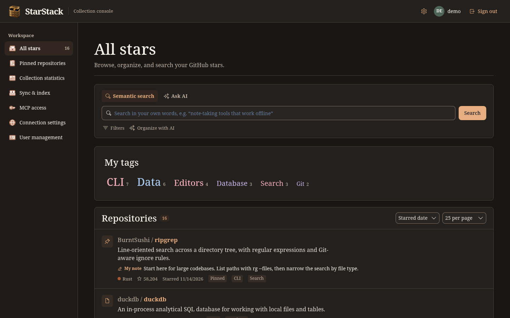
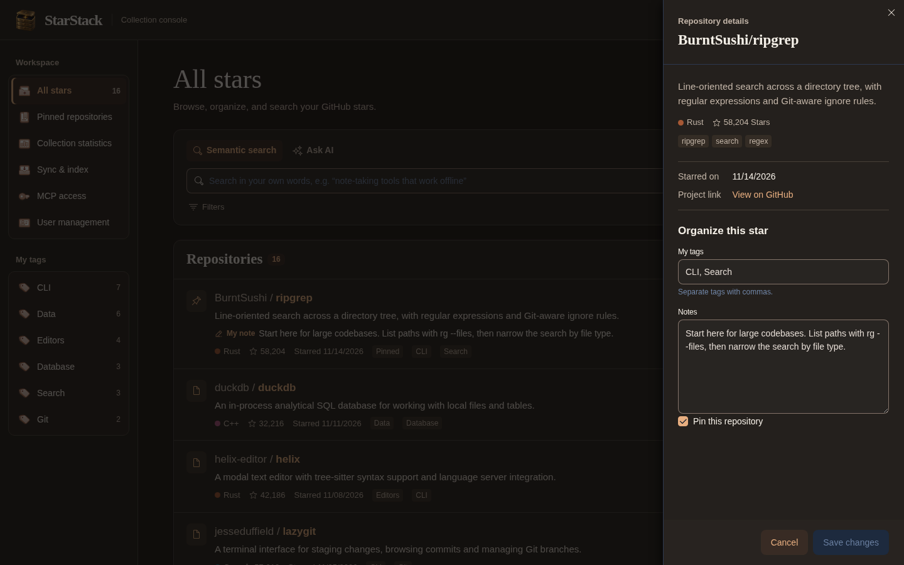
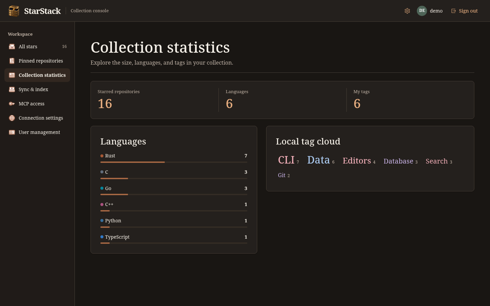
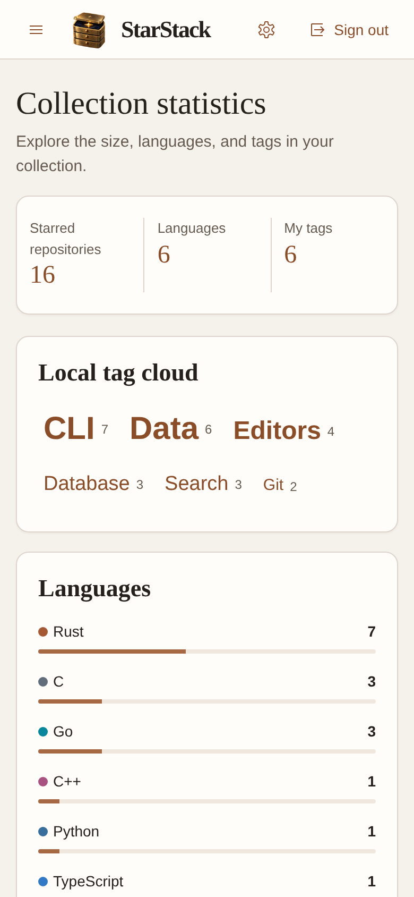
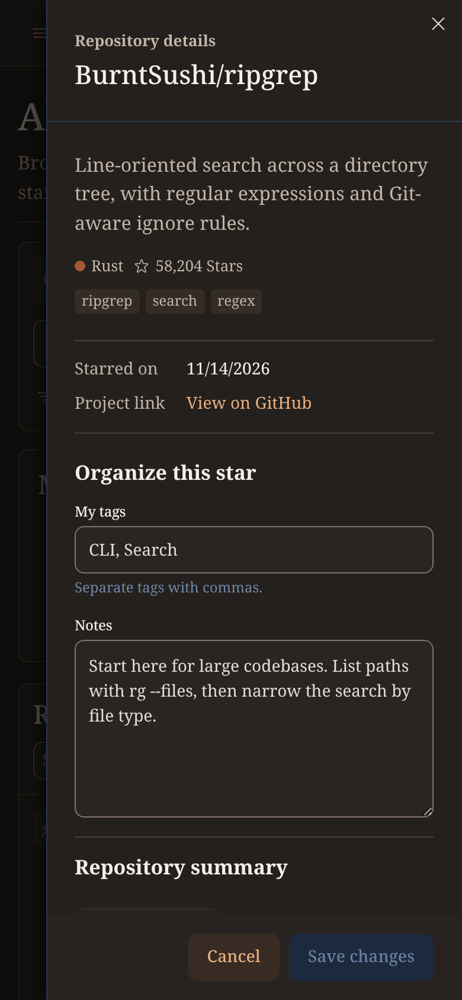
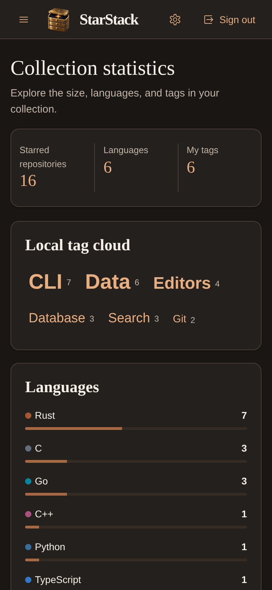

<p align="center"></p>

# StarStack

[简体中文](README.md)

Ask “What was that Rust parser I starred last year?” StarStack searches your own GitHub stars and returns repositories with their links, star dates, private tags and notes. The command line, web dashboard and MCP server ship in one Rust executable.

## First search

1. Build the executable with Rust 1.97.1 or newer, Node.js 24, CMake and a native C/C++ toolchain. Run these commands from the repository root. The result is `target/release/starstack`, with the dashboard embedded. Put it on PATH to use the commands below.

   ```bash
   (cd web && npm ci && npm run build)
   cargo build --release --locked
   ```

2. Download Multilingual MiniLM-L12-v2, the default search model for new libraries. It runs on the local CPU and needs about 458 MiB of model files. To download from ModelScope, replace `huggingface` with `modelscope`.

   ```bash
   starstack models download --source huggingface
   ```

3. Connect your GitHub account. If GitHub CLI is already signed in, run **`starstack auth login --gh`**. StarStack remembers the credential source and reads the token from `gh` when syncing. To use Device Flow instead, register a GitHub OAuth App with Device Flow enabled, set its client ID, then enter the displayed code at GitHub. If the form requires a Redirect URI, enter the same URL as the homepage. See the [Device Flow setup](docs/deploy.md#配置-github-设备授权) for the registration options. The server can reach GitHub through an HTTP or SOCKS5 proxy configured with `STARSTACK_PROXY_URL`. You can enter the device code in any browser with access to GitHub. Alternatively, supply a personal access token through `GITHUB_TOKEN`. Leave the OAuth scope empty for public repositories. For a fine-grained token, grant read access to account **Starring** and to repository **Contents** for private READMEs.

   ```bash
   export STARSTACK_GITHUB_CLIENT_ID='your OAuth app client ID'
   starstack auth login
   ```

4. Sync your collection and ask a question. The first sync saves the repository catalog, fetches a budgeted batch of READMEs, then builds the semantic index.

   ```bash
   starstack sync
   starstack search 'a Go library for local vector search'
   ```

## Dashboard and Docker

On first launch, set `STARSTACK_ADMIN_USER` and `STARSTACK_ADMIN_PASSWORD` (at least eight bytes). Run `starstack serve` and open <http://127.0.0.1:8080/login>. **Sync & index** connects your GitHub account and manages refreshes. Search, filter and edit notes from the library. Display preferences on the login page and dashboard control language and theme.

For Docker, put the following variables in a local `.env` next to `compose.yaml`, replace the placeholders, then run `docker compose up -d --build`. The named volume keeps the library and model files across container recreation. The default published port binds to localhost. To download the search model inside the container, run `docker compose exec starstack starstack models download --source huggingface`.

```dotenv
STARSTACK_ADMIN_USER=admin
STARSTACK_ADMIN_PASSWORD=choose-a-long-unique-password
STARSTACK_GITHUB_CLIENT_ID=your-device-flow-enabled-client-id
STARSTACK_GITHUB_SCOPE=
STARSTACK_SYNC_INTERVAL_MINUTES=360
```

Admins can create and disable users, reset passwords and change roles. Each signed-in user has an independent collection, GitHub authorization, sync schedule and MCP tokens in the shared SQLite database. Password and role changes invalidate that user's sessions and MCP tokens. The local CLI and stdio transport use the initial administrator's library. For other users, connect over HTTP using the token issued by their account. [Deployment guide](docs/deploy.md)

### Built-in and remote search models

Under **Sync & index → Semantic index**, an administrator can download the shared model files from Hugging Face or ModelScope, monitor progress, retry a download or remove an unused model. Operators can point either source at a trusted mirror with `STARSTACK_HF_ENDPOINT` or `STARSTACK_MODELSCOPE_ENDPOINT`. StarStack checks each file against the pinned model revision.

For Ollama embeddings, an administrator adds the server address. Each account can then choose a server and enter an installed model name. That server receives repository text and private annotations during indexing, and query text during search. The built-in model loads its downloaded weights into the StarStack process when an index or query first needs embeddings. An existing deployment that explicitly sets `STARSTACK_MODEL` or `STARSTACK_OLLAMA_URL` keeps Ollama as the default until the account selects a backend. Compose uses `STARSTACK_OLLAMA_DEFAULT_URL` to reach Ollama on the host when needed.

To use the built-in model for the initial library, download it, select it and build the index.

```bash
starstack models download --source modelscope
starstack models select builtin
starstack index --rebuild
```

For remote inference, first run `ollama pull qwen3-embedding:0.6b` on the Ollama server. Then run these commands on the StarStack host, replacing the example URL with the address added by the administrator.

```bash
starstack models select ollama --url http://ollama.example.org:11434 --model qwen3-embedding:0.6b
starstack index --rebuild
```

The catalog also includes native Qwen3-Embedding-0.6B Q4_K_M (about 387 MiB). Run `starstack models download qwen3-embedding-0.6b-q4-k-m --source modelscope`, then `starstack models select builtin --model qwen3-embedding-0.6b-q4-k-m`. Administrators can also search the model hubs or upload files offline. Both catalog models have pinned SHA-256 digests. Custom imports support 384-dimensional, mean-pooled Sentence Transformers BERT models with a single safetensors weight file.

Under **Chunking preset**, choose balanced, short, long or whole-document mode for the current account and backend. New libraries use balanced chunks of 512 characters with a 64-character overlap. Existing Ollama indexes keep their whole-document setting. After changing the model or chunk settings, select **Rebuild index** in that account.

## GitHub Star Lists

StarStack mirrors the lists you maintain on GitHub, including their names and member repositories, through the GraphQL API. Run `starstack lists --refresh` to inspect yours. Private tags are stored in your local StarStack library. A repository can belong to multiple GitHub lists and also carry private tags. [GitHub Stars and Lists](https://docs.github.com/en/get-started/exploring-projects-on-github/saving-repositories-with-stars)

```bash
starstack lists
starstack list --list "Dev tools"
starstack search 'fuzzy search on the command line' --list "Dev tools"
```

List counts come from GitHub. Filtered results include only repositories in the current account’s active star catalog.

Replace `Dev tools` with an existing list name. The MCP tool `search_stars` accepts the equivalent JSON field, for example `{"query":"fuzzy search on the command line","list":"Dev tools"}`.

## Organize and export

Click a tag in the **Local tag cloud** on the statistics page to browse its repositories. In the library, **Organize with AI** can preview one batch or, after confirmation, process all matching repositories in the background. Choose local private tags or existing GitHub lists. Updating GitHub lists requires write access. If you filter by tag, run the filter again after applying changes to refresh the results.

AI organization and recommendations use a separate chat model. An administrator must configure Aimux in the dashboard or explicitly set the environment variables below before the first request. For Ollama, run `ollama pull qwen3:4b` on the chat server and replace the example URL with an address StarStack can reach.

```bash
export STARSTACK_AI_PROVIDER=ollama
export STARSTACK_AI_BASE_URL=http://ollama.example.org:11434/v1
export STARSTACK_AI_MODEL=qwen3:4b
```

Restart StarStack after setting these values. Organization sends the selected chat service repository names, descriptions, languages, topics, existing tags and list names. Semantic search also works with chat unconfigured.

Replace the repository name with one of your stars.

```bash
starstack list --sort stars --language Rust --archived false
starstack tag clap-rs/clap cli
starstack note clap-rs/clap 'Use this for the next release tool'
starstack pin clap-rs/clap
starstack index
starstack search 'command line parsing' --tag cli
starstack export --pinned true --output shortlist.md
starstack export --format json --output stars.json
```

Edits appear immediately in the list. The next search refreshes stale annotation embeddings. Run the incremental indexer to update them in advance. Shared exports include the matching private annotations. [Markdown example](examples/collection.md) · [JSON example](examples/collection.json)

## Ask an assistant

- **In StarStack**, use AI recommendations in the dashboard or run `starstack ask 'Which CLI library from my stars should I use?'`. Configure a chat provider first. Aimux can connect to a remote provider using `STARSTACK_AI_PROVIDER`, `STARSTACK_AI_MODEL`, `STARSTACK_AI_BASE_URL` and `STARSTACK_AI_API_KEY`. The question plus the names, descriptions and languages of up to five candidates go to that provider. Numbered references correspond to the result links.
- **In Claude Desktop**, add the example configuration to your MCP settings, replacing the binary and data paths. The official Rust SDK also serves Streamable HTTP at `/mcp`. Generate a token in the dashboard and send `Authorization: Bearer <StarStack token>` with requests. For a remote HTTPS endpoint, configure your domain in `STARSTACK_MCP_HOSTS`. The tools expose semantic search, repository details, tags, stats and a sync request. Confirm the latter in the dashboard before the sync runs. [Claude Desktop configuration](examples/claude_desktop_config.json) · [MCP tool reference](docs/mcp.md)

## Updates and recovery

- Use `starstack sync --catalog-only` for a large initial import. It pages through stars, saves repository metadata and syncs GitHub lists. You can browse immediately or run `starstack index` to search the available text. Subsequent catalog runs are incremental. Add `--full` to read all pages again.
- Run `sync` for recent stars or `sync --full` to refresh older metadata and reconcile unstars. Personal notes survive an unstar and reappear if you star the same repository again.
- The dashboard schedules a full catalog refresh every six hours and processes queued READMEs in the background every 30 minutes, updating embeddings for changed text. Each user can adjust both intervals in **Sync & index**. Set either to zero to disable that job.
- The semantic index includes the repository name, description, language, topics, license, README and private annotations. For the initial library, run `starstack index --rebuild` after changing the model or chunk settings, or to recover a damaged index.
- StarStack tracks REST and GraphQL rate windows separately for each upstream account. The default policy reserves 5% of the allowance and budgets 200 README requests per run. Catalog requests can use the reserve. A rate-limited or failed README stays in the queue, preserving the previous text and private annotations. Follow the retry time in the summary. Reauthorize an expired credential. If the search model is unavailable, synced metadata stays in the library. Finish the built-in model download or restore the selected Ollama service, then run `starstack index`.
- Stop writers before backing up the entire `STARSTACK_HOME`. The directory includes SQLite, the HawDB projections and the GitHub device credential. Keep the backup private.

The CLI processes one README batch in the foreground. Dashboard users can set their own batch budget, reserve and fetch method. Releases include Firecrawl Local. Each account can use the GitHub API or select Firecrawl Local to parse public repository pages locally. Private repositories and repositories with unknown visibility use the GitHub REST API. Firecrawl Local uses the AGPL-3.0 license. [Deployment](docs/deploy.md) · [Firecrawl Local](https://crates.io/crates/firecrawl-local/0.1.1)

## Screenshots

These screenshots show a separate example library. The repository names refer to public projects. Star counts, saved dates, tags and notes are sample data. Select an image to see it at full size.

### Desktop · 1440 × 900

#### Light

| Library | Repository details | Collection statistics |
| --- | --- | --- |
| [](docs/screenshots/en-desktop-light-library.webp) | [](docs/screenshots/en-desktop-light-detail.webp) | [](docs/screenshots/en-desktop-light-statistics.webp) |

#### Dark

| Library | Repository details | Collection statistics |
| --- | --- | --- |
| [](docs/screenshots/en-desktop-dark-library.webp) | [](docs/screenshots/en-desktop-dark-detail.webp) | [](docs/screenshots/en-desktop-dark-statistics.webp) |


### Mobile · 390 × 844

#### Light

| Library | Repository details | Collection statistics |
| --- | --- | --- |
| [](docs/screenshots/en-mobile-light-library.webp) | [](docs/screenshots/en-mobile-light-detail.webp) | [](docs/screenshots/en-mobile-light-statistics.webp) |

#### Dark

| Library | Repository details | Collection statistics |
| --- | --- | --- |
| [](docs/screenshots/en-mobile-dark-library.webp) | [](docs/screenshots/en-mobile-dark-detail.webp) | [](docs/screenshots/en-mobile-dark-statistics.webp) |
