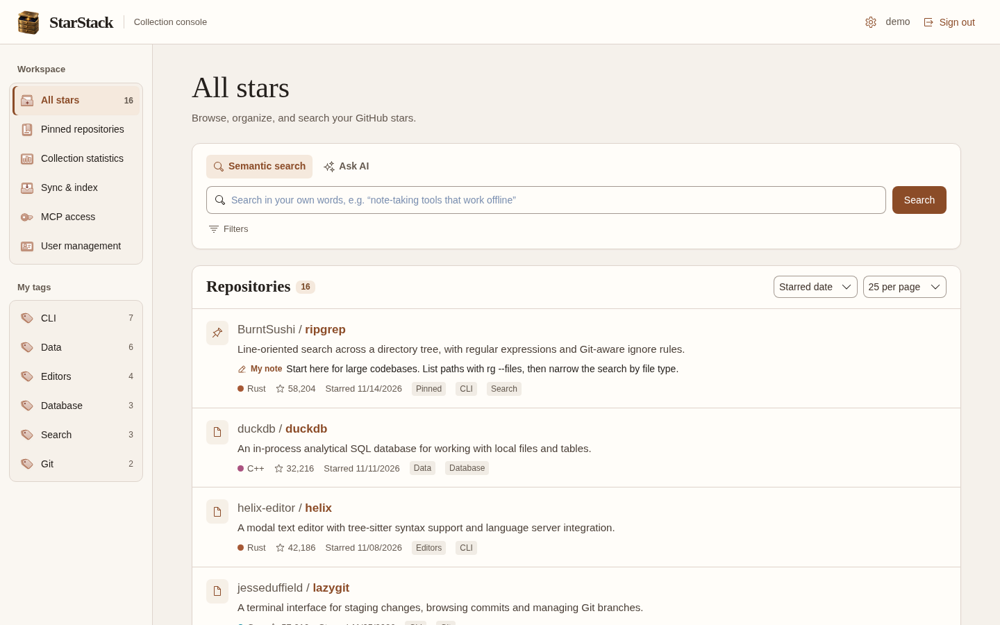
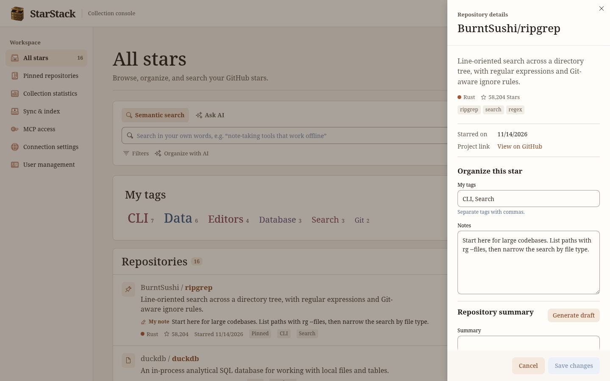
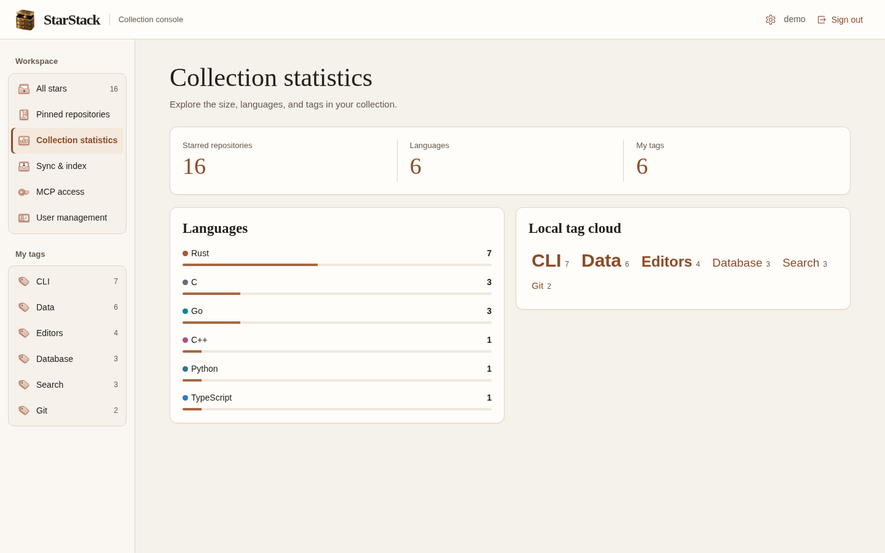
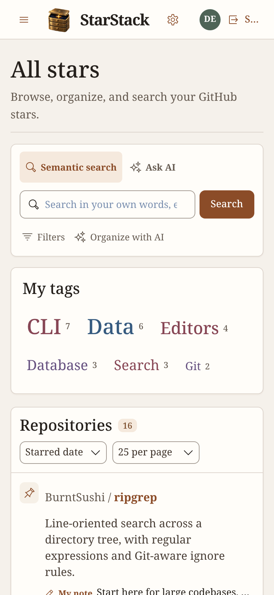
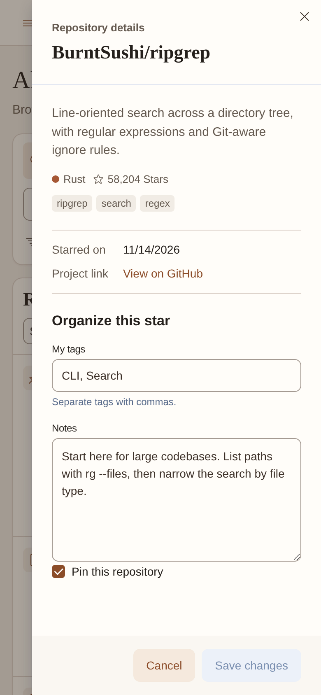
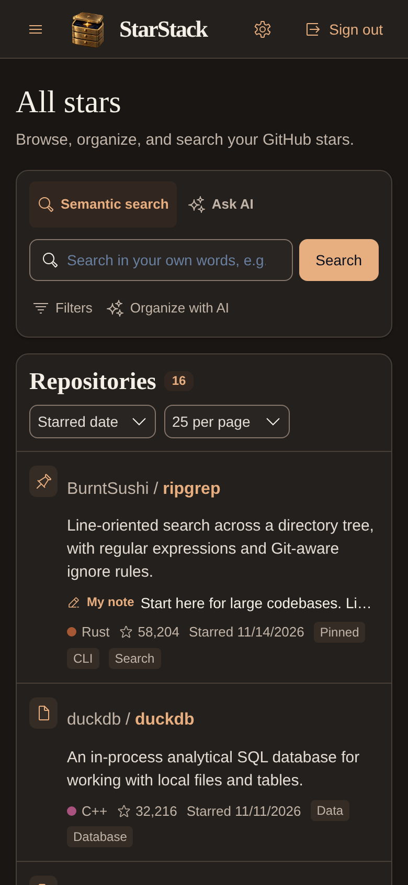

<p align="center"></p>

# StarStack

[简体中文](README.md)

Ask “What was that Rust parser I starred last year?” StarStack searches your own GitHub stars and returns repositories with their links, star dates, private tags and notes. The command line, web dashboard and MCP server ship in one Rust executable.

## First search

1. Build the executable with Rust 1.97.1 or newer, Node.js 24, CMake and a native C/C++ toolchain. Run these commands from the repository root. The result is `target/release/starstack`, with the dashboard embedded. Put it on PATH to use the commands below.

   ```bash
   (cd web && npm ci && npm run build)
   cargo build --release --locked
   ```

2. Download Multilingual MiniLM-L12-v2, the default search model for new libraries. It runs on the local CPU and needs about 458 MiB of model files. To download from ModelScope, replace `huggingface` with `modelscope`.

   ```bash
   starstack models download --source huggingface
   ```

3. Connect your GitHub account. If GitHub CLI is already signed in, run **`starstack auth login --gh`**. StarStack remembers the credential source and reads the token from `gh` when syncing. To use Device Flow instead, register a GitHub OAuth App with Device Flow enabled, set its client ID, then enter the displayed code at GitHub. If the form requires a Redirect URI, enter the same URL as the homepage. See the [Device Flow setup](docs/deploy.md#配置-github-设备授权) for the registration options. The server can reach GitHub through an HTTP or SOCKS5 proxy configured with `STARSTACK_PROXY_URL`. You can enter the device code in any browser with access to GitHub. Alternatively, supply a personal access token through `GITHUB_TOKEN`. Leave the OAuth scope empty for public repositories. For a fine-grained token, grant read access to account **Starring** and to repository **Contents** for private READMEs.

   ```bash
   export STARSTACK_GITHUB_CLIENT_ID='your OAuth app client ID'
   starstack auth login
   ```

4. Sync your collection and ask a question. The first sync saves the repository catalog, fetches a budgeted batch of READMEs, then builds the semantic index.

   ```bash
   starstack sync
   starstack search 'a Go library for local vector search'
   ```

## Dashboard and Docker

Run `starstack serve` and open <http://127.0.0.1:8080/login>. Choose a username and password to create the first administrator. For unattended setup, set both `STARSTACK_ADMIN_USER` and `STARSTACK_ADMIN_PASSWORD` before the first launch.

**Sync & index** has tabs for star sync, schedule and quotas, semantic indexing, the model market, and AI chat. The GitHub connection panel lets you reauthorize or disconnect. The AI chat form loads available models based on the selected provider, URL and API key. For an OpenAI-compatible gateway, choose Responses or Chat Completions and test the selected model before saving.

For Docker, put the following variables in a local `.env` next to `compose.yaml`, replace the placeholders, then run `docker compose up -d --build`. The named volume keeps the library and model files across container recreation. The default published port binds to localhost. To download the search model inside the container, run `docker compose exec starstack starstack models download --source huggingface`.

```dotenv
STARSTACK_ADMIN_USER=admin
STARSTACK_ADMIN_PASSWORD=choose-a-long-unique-password
STARSTACK_GITHUB_CLIENT_ID=your-device-flow-enabled-client-id
STARSTACK_GITHUB_SCOPE=
STARSTACK_SYNC_INTERVAL_MINUTES=360
```

Admins can create, disable or delete other accounts, reset their passwords and change roles. Each signed-in user has an independent collection, GitHub authorization, sync schedule and MCP tokens in the shared SQLite database. Password and role changes invalidate that user's sessions and MCP tokens. The local CLI and stdio transport use the initial administrator's library. For other users, connect over HTTP using the token issued by their account. Click your avatar to edit your display name. Every user can configure a personal GitHub proxy in **Connection settings → Personal proxy** and test it against Cloudflare before saving. Admins can set the instance default on the same page. [Deployment guide](docs/deploy.md)

In a repository’s detail panel, generate a summary draft, edit it, and save it locally. Ask follow-up questions about the code and review the source paths cited in each answer. Code Q&A sends selected source and README excerpts to the configured chat provider. Saved summaries are indexed, and you can choose which code excerpts to keep in the index. For regression investigation, opt in to commit tracking on individual repositories. Fetch 20 commits by default or choose all available default-branch history. Previously observed SHA records are kept when a baseline check detects a rewrite. The latest 100 commit messages are included in semantic search.

In **Sync & index → Schedule & quotas**, choose whether star sync, README enrichment, and AI auto-organization retry after temporary failures. StarStack uses exponential backoff for up to five retries and honors server retry delays. Star and README retries follow their schedule settings. AI organization resumes from saved progress. Authentication errors require attention.

The web app queues semantic indexing as soon as a star sync commits. Repository metadata is indexed first, then scheduled README enrichment updates it. **Sync & index** shows newly computed and reused repositories, completed text chunks, processed tokens, and compute time. Built-in models count successfully processed non-padding tokens, including special tokens and overlapping windows. Ollama may omit the count. If indexing needs attention, correct the model in **Semantic index**. Select **Update index** after installing missing files, or **Rebuild index** after changing the model or chunking.

Built-in models offer **Quiet**, **Balanced**, and **Performance** indexing profiles under **Sync & index → Semantic index**. They use one, half, or all available CPU threads, capped at 16. An active job can switch profiles after saving its current batch. Ollama controls its threads on the remote server. Completed repository embeddings are checkpointed as each batch finishes. Indexing resumes automatically after a restart and shows the number of checkpoints reused.

Star sync, Schedule & quotas, and Semantic index each show their own task status. The index tab shows published coverage, last update, and disk usage. While the semantic index is unavailable, web search falls back to keywords across repository metadata and private annotations. The token receipt on the MCP access page shows authenticated request counts and the most recent use for active tokens.

Deleted, inaccessible, and unstarred repositories leave the library and search results after the next successful full sync. The next index update removes their vectors. Scheduled star sync checks the full list. Incremental sync reads recent stars.

### Built-in and remote search models

Under **Sync & index → Model market**, an administrator can download the shared model files from Hugging Face or ModelScope, monitor progress, retry a download or remove an unused model. Operators can point either source at a trusted mirror with `STARSTACK_HF_ENDPOINT` or `STARSTACK_MODELSCOPE_ENDPOINT`. StarStack checks each file against the pinned model revision.

For Ollama embeddings, an administrator adds the server address. Each account can then choose a server and enter an installed model name. That server receives repository text and private annotations during indexing, and query text during search. The built-in model loads its downloaded weights into the StarStack process when an index or query first needs embeddings. An existing deployment that explicitly sets `STARSTACK_MODEL` or `STARSTACK_OLLAMA_URL` keeps Ollama as the default until the account selects a backend. Compose uses `STARSTACK_OLLAMA_DEFAULT_URL` to reach Ollama on the host when needed.

To use the built-in model for the initial library, download it, select it and build the index.

```bash
starstack models download --source modelscope
starstack models select builtin
starstack index --rebuild
```

For remote inference, first run `ollama pull qwen3-embedding:0.6b` on the Ollama server. Then run these commands on the StarStack host, replacing the example URL with the address added by the administrator.

```bash
starstack models select ollama --url http://ollama.example.org:11434 --model qwen3-embedding:0.6b
starstack index --rebuild
```

The catalog also includes native Qwen3-Embedding-0.6B Q4_K_M (about 387 MiB). Run `starstack models download qwen3-embedding-0.6b-q4-k-m --source modelscope`, then `starstack models select builtin --model qwen3-embedding-0.6b-q4-k-m`. Administrators can also search the model hubs or upload files offline. Both catalog models have pinned SHA-256 digests. Custom imports support 384-dimensional, mean-pooled Sentence Transformers BERT models with a single safetensors weight file.

Built-in models use their bundled tokenizer to split long inputs into overlapping windows automatically. With Ollama, **Semantic index → Chunking preset** sets the size of each text chunk sent to your account’s Ollama server. Accounts without a saved Ollama preset use Balanced. The whole-document preset sends each metadata or body section as one input.

For Ollama indexing, `STARSTACK_OLLAMA_BATCH_SIZE` sets the number of inputs per request (default 64, range 1–128), and `STARSTACK_OLLAMA_CONCURRENCY` sets the maximum simultaneous requests (default 2, range 1–4). The inference timer includes network time. The built-in model runs in-process.

StarStack embeds the repository metadata and private annotations separately from the cleaned README, saved code excerpts and commit text. It combines the two parts into one repository vector and can reuse the unchanged part on later updates. The instance setting `STARSTACK_README_INDEX_CHARS` limits the cleaned README to 4,000 Unicode characters by default. Set it to `0` to omit the README from the embedding input, or to a value up to `65536`. README fetching and storage have their own settings.

On a first structured index build with repository text available, StarStack publishes searchable metadata first. It then processes repository text, starting with pinned and recently starred repositories. **Semantic index** shows when the text index is pending.

After upgrading an index built with the earlier text layout or changing its model, chunking or README limit, choose **Rebuild index** in each affected account. Use `starstack index --rebuild` for the initial administrator’s library. Search combines semantic and keyword rankings. Exact project names can surface through keyword matching even when their semantic similarity is low.

### Evaluate search on your own stars

Put one JSON object per line in `queries.jsonl`. Use questions representative of your searches, with one or more expected repositories already in your library.

```jsonl
{"query":"search for text in a directory tree","expect":["BurntSushi/ripgrep"]}
{"query":"interactive command-line fuzzy finder","expect":["junegunn/fzf"]}
```

Run `starstack eval --queries queries.jsonl` against the published index. It reports mean Recall@5, MRR@100, and p50/p95 query latency in milliseconds. Compare runs on the same collection and queries after rebuilding each configuration.

## GitHub Star Lists

StarStack mirrors the lists you maintain on GitHub, including their names and member repositories, through the GraphQL API. Run `starstack lists --refresh` to inspect yours. Private tags are stored in your local StarStack library. A repository can belong to multiple GitHub lists and also carry private tags. [GitHub Stars and Lists](https://docs.github.com/en/get-started/exploring-projects-on-github/saving-repositories-with-stars)

```bash
starstack lists
starstack list --list "Dev tools"
starstack search 'fuzzy search on the command line' --list "Dev tools"
```

List counts come from GitHub. Filtered results include only repositories in the current account’s active star catalog.

Replace `Dev tools` with an existing list name. The MCP tool `search_stars` accepts the equivalent JSON field, for example `{"query":"fuzzy search on the command line","list":"Dev tools"}`.

## Organize and export

Natural-language search shows 25 repositories initially. Choose a batch size of 10, 25, 50, or 100, then select **Load more** below the results to see more matches with the same filters. Existing cards stay in place when you load another batch or retry. Keyword fallback also supports loading more results.

The tag clouds in the library and on the statistics page give each tag a consistent color. Type size reflects its repository count. Select a tag to browse those repositories. In the library, **Organize with AI** can preview one batch or, after confirmation, process all matching repositories in the background. Choose local private tags or existing GitHub lists. Updating GitHub lists requires write access. If you filter by tag, run the filter again after applying changes to refresh the results.

AI organization and recommendations use a separate chat model. An administrator must configure Aimux in the dashboard or explicitly set the environment variables below before the first request. For Ollama, run `ollama pull qwen3:4b` on the chat server and replace the example URL with an address StarStack can reach.

```bash
export STARSTACK_AI_PROVIDER=ollama
export STARSTACK_AI_BASE_URL=http://ollama.example.org:11434/v1
export STARSTACK_AI_MODEL=qwen3:4b
```

Restart StarStack after setting these values. Organization sends the selected chat service repository names, descriptions, languages, topics, existing tags and list names. Semantic search also works with chat unconfigured.

Replace the repository name with one of your stars.

```bash
starstack list --sort stars --language Rust --archived false
starstack tag clap-rs/clap cli
starstack note clap-rs/clap 'Use this for the next release tool'
starstack pin clap-rs/clap
starstack index
starstack search 'command line parsing' --tag cli
starstack export --pinned true --output shortlist.md
starstack export --format json --output stars.json
```

Edits appear immediately in the list. The next search refreshes stale annotation embeddings. Run the incremental indexer to update them in advance. Shared exports include the matching private annotations. [Markdown example](examples/collection.md) · [JSON example](examples/collection.json)

## Ask an assistant

- **In StarStack**, use AI recommendations in the dashboard or run `starstack ask 'Which CLI library from my stars should I use?'`. Configure a chat provider first. Aimux can connect to a remote provider using `STARSTACK_AI_PROVIDER`, `STARSTACK_AI_MODEL`, `STARSTACK_AI_BASE_URL` and `STARSTACK_AI_API_KEY`. The question plus the names, descriptions and languages of up to five candidates go to that provider. Numbered references correspond to the result links.
In **MCP access → Search and recommendations**, you can opt into AI query expansion and recommendations. MCP always uses your account’s embedding index for the search itself.

- **In Claude Desktop**, add the example configuration to your MCP settings, replacing the binary and data paths. The official Rust SDK also serves Streamable HTTP at `/mcp`. Generate a token in the dashboard and send `Authorization: Bearer <StarStack token>` with requests. For a remote HTTPS endpoint, configure your domain in `STARSTACK_MCP_HOSTS`. The tools expose semantic search, repository details, tags, stats and a sync request. Confirm the latter in the dashboard before the sync runs. [Claude Desktop configuration](examples/claude_desktop_config.json) · [MCP tool reference](docs/mcp.md)

## Updates and recovery

- Use `starstack sync --catalog-only` for a large initial import. It pages through stars, saves repository metadata and syncs GitHub lists. You can browse immediately or run `starstack index` to search the available text. Subsequent catalog runs are incremental. Add `--full` to read all pages again.
- Run `sync` for recent stars or `sync --full` to refresh older metadata and reconcile unstars. Personal notes survive an unstar and reappear if you star the same repository again.
- The dashboard schedules a full catalog refresh every six hours and processes queued READMEs in the background every 30 minutes, updating embeddings for changed text. Each user can adjust both intervals in **Sync & index**. Set either to zero to disable that job.
- The semantic index includes the repository name, description, language, topics, license, README and private annotations. For the initial library, run `starstack index --rebuild` after changing the model or chunk settings, or to recover a damaged index.
- StarStack tracks REST and GraphQL rate windows separately for each upstream account. The default policy reserves 5% of the allowance and budgets 200 README requests per run. Catalog requests can use the reserve. A rate-limited or failed README stays in the queue, preserving the previous text and private annotations. Follow the retry time in the summary. Reauthorize an expired credential. If the search model is unavailable, synced metadata stays in the library. Finish the built-in model download or restore the selected Ollama service, then run `starstack index`.
- Stop writers before backing up the entire `STARSTACK_HOME`. SQLite stores account, library, and index metadata. HawDB stores full-precision vectors and checkpoints in its immutable object store, plus a quantized search projection. Upgrades migrate existing SQLite embeddings and checkpoints without recomputing valid vectors. The backup should include SQLite, the HawDB projections and vector object directories, and the GitHub device credential. Keep the backup private.

In **Sync & index → Schedule & quotas**, enable **Speed up the first README backfill** to use spare quota reported by GitHub during the initial import. It can raise a positive per-run request budget to 1,000, keeps any higher configured budget, and returns to the configured budget when the queue first empties. The GitHub source can fetch up to three public root READMEs in a single GraphQL request. Missing or unsuitable results use REST. A failed Firecrawl fetch also falls back to authenticated REST as quota allows.

The CLI processes one README batch in the foreground. Dashboard users can set their own batch budget, reserve and fetch method. Releases include Firecrawl Local. Each account can use the GitHub API or select Firecrawl Local to parse public repository pages locally. Private repositories and repositories with unknown visibility use the GitHub REST API. Firecrawl Local uses the AGPL-3.0 license. [Deployment](docs/deploy.md) · [Firecrawl Local](https://crates.io/crates/firecrawl-local/0.1.1)

## Screenshots

These screenshots show a separate example library. The repository names refer to public projects. Star counts, saved dates, tags and notes are sample data. Select an image to see it at full size.

### Desktop · 1440 × 900

#### Light

| Library | Repository details | Collection statistics |
| --- | --- | --- |
| [](docs/screenshots/en-desktop-light-library.webp) | [](docs/screenshots/en-desktop-light-detail.webp) | [](docs/screenshots/en-desktop-light-statistics.webp) |

#### Dark

| Library | Repository details | Collection statistics |
| --- | --- | --- |
| [](docs/screenshots/en-desktop-dark-library.webp) | [](docs/screenshots/en-desktop-dark-detail.webp) | [](docs/screenshots/en-desktop-dark-statistics.webp) |


### Mobile · 390 × 844

#### Light

| Library | Repository details | Collection statistics |
| --- | --- | --- |
| [](docs/screenshots/en-mobile-light-library.webp) | [](docs/screenshots/en-mobile-light-detail.webp) | [](docs/screenshots/en-mobile-light-statistics.webp) |

#### Dark

| Library | Repository details | Collection statistics |
| --- | --- | --- |
| [](docs/screenshots/en-mobile-dark-library.webp) | [](docs/screenshots/en-mobile-dark-detail.webp) | [](docs/screenshots/en-mobile-dark-statistics.webp) |
