<p align="center"></p>

# 星栈 / StarStack

[English](README.en.md)

「去年 star 的那个 Rust 解析器叫什么？」星栈从你自己的 GitHub 收藏里按语义查找，返回仓库链接、收藏日期，以及你留下的标签和备注。一个 Rust 二进制同时提供 CLI、Web 管理后台和 MCP 服务。

## 从零到第一次检索

1. **构建或取得二进制。** 从源码构建需要 Rust 1.97.1 或更新版本、Node.js 24、CMake 和本机 C/C++ 工具链。以下命令在仓库根目录运行，生成的 `target/release/starstack` 已内置 Web 界面。后文用 `starstack` 指代这个文件，可将它放入 PATH。用 Docker 运行见[部署说明](docs/deploy.md)。

   ```bash
   (cd web && npm ci && npm run build)
   cargo build --release --locked
   ```

2. **下载检索模型。** 新资料库默认使用 Multilingual MiniLM-L12-v2，在本机 CPU 上计算向量。首次使用从 Hugging Face 下载约 458 MiB 的模型文件。使用 ModelScope 时，把下面的 `huggingface` 换成 `modelscope`。

   ```bash
   starstack models download --source huggingface
   ```

3. **连接自己的 GitHub。** 本机已登录 GitHub CLI 时，运行 **`starstack auth login --gh`** 即可。星栈仅记录凭证来源，在同步时向本机 `gh` 读取当前账号的凭证。已有个人 token 也可设 `GITHUB_TOKEN`。使用设备码时，设置你自己的 GitHub OAuth App 的 Client ID，然后在浏览器输入星栈显示的短码。如果服务器需要代理，可先设置环境变量 `STARSTACK_PROXY_URL`，支持 HTTP 和 SOCKS5；输入短码可使用另一台能访问 GitHub 的设备。访问公开收藏可保持默认的空 scope。GitHub 注册表单里的 Redirect URI 可填写同一个 Homepage URL。完整选项和 Compose 参数见[设备授权设置](docs/deploy.md#配置-github-设备授权)。

   ```bash
   export STARSTACK_GITHUB_CLIENT_ID='你的 OAuth App Client ID'
   starstack auth login
   ```

4. **同步并检索。** 首次同步遍历全部收藏，先保存仓库描述、语言、topics 和许可证，再按本轮预算补抓 README 并建立本地索引。完成后即可用中文或英文查询。示例查询的结果取决于你实际收藏的项目。

   ```bash
   starstack sync
   starstack search '那个做本地向量检索的 Go 库'
   ```

## 使用管理后台

运行 `starstack serve`，打开 <http://127.0.0.1:8080/login>。首次打开时自行填写用户名和密码，首位用户自动成为管理员。无人值守部署可同时设置 `STARSTACK_ADMIN_USER` 和 `STARSTACK_ADMIN_PASSWORD`。

「同步与索引」分为「收藏同步」「计划与额度」「语义索引」「模型市场」「AI 聊天」五个标签页。连接 GitHub 后可重新授权或断开连接，本地收藏和批注会保留。配置 AI 聊天服务的地址和密钥后，星栈会获取可选模型。 OpenAI 兼容网关可选择 Responses 或 Chat Completions，保存前可先测试模型。

管理员可以创建、删除其他账号，或为其调整角色和重置密码。每个账号拥有自己的收藏、批注、GitHub 授权、定时配置和 MCP token。管理员的初始库与本机 CLI 共用；其他用户通过 Web 或带个人 token 的 HTTP MCP 访问自己的收藏。密码或角色变更后重新登录，并为助手签发新 token。点击右上角头像可修改昵称。在「用户管理 → 实例代理」可以先测试能否访问 Cloudflare，再保存设置。

在仓库详情里，可生成一份总结草稿，编辑后保存在本地。也可向 AI 询问代码，按回答附带的文件路径核对来源。问答会发送少量相关源文件和 README 摘录给配置的聊天服务。总结保存后会纳入索引，代码片段可手动保存或移除。需要排查回归时，在指定仓库开启「提交记录与基线」，默认抓取 20 条，也可以记录全部默认分支历史。刷新会保留已见 SHA 和原始提交说明，并在 GitHub 无法确认快进关系时提示。最近 100 条说明进入语义索引。

### 选择内置或远端检索模型

在「同步与索引 → 模型市场」查找、下载或导入模型，管理员可在「已安装」查看进度和管理共享文件。各账号在「语义索引」选择要使用的模型。如果选择 Ollama，管理员先添加可用的服务地址，各账号再选择地址并填写该服务已安装的模型名。该服务会收到用于索引的仓库文本、私人批注和搜索时的查询。内置模型在本机处理这些内容。

**内置模型。** 首次索引或查询需要计算向量时，星栈才将已下载的权重加载到当前进程。以下命令使用 ModelScope 配置本机初始库。

```bash
starstack models download --source modelscope
starstack models select builtin
starstack index --rebuild
```

**远端 Ollama。** 先在 Ollama 服务器上运行 `ollama pull qwen3-embedding:0.6b`。管理员将该服务加入「管理 Ollama 服务地址」后，在运行星栈的机器上执行以下命令，并将示例地址替换为已添加的地址。

```bash
starstack models select ollama --url http://ollama.example.org:11434 --model qwen3-embedding:0.6b
starstack index --rebuild
```

内置目录还提供原生 Qwen3-Embedding-0.6B Q4_K_M，下载约 387 MiB。运行 `starstack models download qwen3-embedding-0.6b-q4-k-m --source modelscope`，再运行 `starstack models select builtin --model qwen3-embedding-0.6b-q4-k-m` 即可选用。管理员也可搜索模型库或上传离线文件。两款预设会核对固定 SHA-256，自定义模型支持单文件 safetensors 权重、384 维均值池化的 Sentence Transformers BERT 模型。

在「分块预设」中，每个账号可为当前后端选择均衡、短分块、长分块或整篇。新库默认均衡，每块 512 个字符，相邻块重叠 64 个字符。原有 Ollama 索引沿用整篇。更改检索模型或分块设置后，在该账号下选择「重建索引」。部署者可为任一下载源配置镜像。[模型下载、镜像与索引设置](docs/deploy.md#检索模型与分块)

## GitHub 收藏分类

在 GitHub Stars 中手工创建的 Lists 通过 GraphQL 同步，保留分类名称和成员关系。先运行 `starstack lists --refresh` 查看自己的分类，再按名称筛选。私人标签由星栈保存在本地，同一仓库可以同时属于多个 GitHub 分类并带有私人标签。[GitHub Stars 与 Lists](https://docs.github.com/en/get-started/exploring-projects-on-github/saving-repositories-with-stars)

```bash
starstack lists
starstack list --list "Dev tools"
starstack search '命令行模糊搜索' --list "Dev tools"
```

将 `Dev tools` 替换成已有分类名。分类总览显示 GitHub 返回的成员数，筛选结果只包含当前账号仍在收藏目录中的仓库。MCP 工具 `search_stars` 接受相同含义的 JSON 参数，例如 `{"query":"命令行模糊搜索","list":"Dev tools"}`。

## 整理与导出

在「收藏统计」的「本地标签云」中点击标签，即可查看对应仓库。在收藏库中打开「AI 整理」，可以逐批预览建议，也可以确认让后台自动整理当前筛选范围。目标可选本地私人标签或已有的 GitHub 收藏分类，写入 GitHub 需有相应权限。按标签筛选时，应用更改后重新查询以刷新匹配结果。

AI 整理和 AI 推荐共用单独的聊天模型。首次使用前，管理员在后台配置 Aimux，或显式设置下列环境变量。以 Ollama 为例，先在聊天服务器运行 `ollama pull qwen3:4b`。将示例地址换成 StarStack 能访问的服务器。

```bash
export STARSTACK_AI_PROVIDER=ollama
export STARSTACK_AI_BASE_URL=http://ollama.example.org:11434/v1
export STARSTACK_AI_MODEL=qwen3:4b
```

配置后重新启动 StarStack。整理请求向所选聊天服务发送仓库名称、简介、语言、主题及已有标签和分类名。配置聊天服务之前也可以使用语义检索。

```bash
starstack list --sort stars --language Rust --archived false
starstack tag clap-rs/clap 命令行
starstack note clap-rs/clap '下次给发布工具加子命令时用'
starstack pin clap-rs/clap
starstack index
starstack search '做命令行工具' --tag 命令行 --since 2025-01-01
starstack export --pinned true --output 精选.md
starstack export --format json --output stars.json
```

把仓库名替换为自己的收藏。列表和详情会立即显示修改。下次检索会自动补齐变化的批注向量，也可用 `starstack index` 提前更新。导出的文件包含私人批注，请在分享前核对。[Markdown 示例](examples/collection.md) · [JSON 示例](examples/collection.json)

在「同步与索引 → 计划与额度」可分别开关收藏同步、README 补全和 AI 自动整理的失败重试。临时失败会指数退避，最多补试五次，并遵循服务端要求的等待时间。同步与 README 的重试受各自的定时设置约束。AI 整理从已保存的进度继续，认证错误需要手动处理。

Web 端每次提交收藏同步结果后会自动更新语义索引，先让仓库元数据可检索，再随后台 README 补全更新内容。在「同步与索引」可以查看新计算和复用的仓库数、已完成的文本块、实际 token 数和计算用时。内置模型统计成功推理的非填充 token，包含模型的特殊 token 和重叠窗口。Ollama 未提供计数时显示「服务未报告」。如果模型告警出现，请在「语义索引」修正配置，安装缺失模型后点击「更新索引」，更换模型或分块配置后点击「重建索引」。

删除、转为不可访问或取消 Star 的仓库，会在下一次成功的全量同步时移出收藏和检索范围，随后从向量索引清理。计划中的收藏同步会做全量核对。增量同步只读取近期 Star。

## AI 与 MCP

MCP 默认使用当前账号的 Embedding 索引。在「MCP 接入 → 检索与推荐」开启 AI 后，星栈会先补充查询关键词，再根据召回结果生成建议。[MCP 工具说明](docs/mcp.md)

- **在星栈内询问**。选择「AI 推荐」，或运行 `starstack ask '帮我从收藏里挑个 CLI 库'`。通过 Aimux 配置聊天服务后，问题和最多五个候选仓库的名称、描述及语言会发送给那个 provider，回答中的编号对应返回的仓库链接。[模型配置](docs/deploy.md)
- **在 AI 助手里询问**。Claude Desktop 可通过 stdio 启动星栈。多用户服务提供 `/mcp`，支持在后台签发、撤销按用户隔离的 Bearer token。助手申请同步后，由用户在星栈中确认。[接入步骤](docs/mcp.md) · [Claude Desktop 示例](examples/claude_desktop_config.json)

## 同步和恢复

| 场景 | 行为与操作 |
| --- | --- |
| 首次导入大库 | `starstack sync --catalog-only` 遍历 Stars 分页，保存仓库目录和 GitHub 分类，可直接浏览。运行 `starstack index` 可先用已有文本检索。之后的 `--catalog-only` 使用增量游标，添加 `--full` 可重新读取全部分页。 |
| 日常新增 | `starstack sync` 从最近收藏开始增量拉取，同一时间戳的记录一起核对。 |
| 旧仓库改名、说明更新、unstar | `starstack sync --full` 或后台定时任务完整核对。取消收藏后从列表和检索中移除；重新 star 会找回本地批注。 |
| 定时刷新 | 仅在 Web 服务运行时执行。默认每 360 分钟全量核对目录。后台 README 任务默认每 30 分钟消费一批待处理仓库，再更新变化的向量。两个周期均可按用户调整，设为 0 可关闭对应任务。 |
| 更换检索模型、分块设置或索引受损 | 在「语义索引」选择「重建索引」。本机初始库也可运行 `starstack index --rebuild`。批注保存在 SQLite。 |
| GitHub 限流或 token 失效 | 星栈按账户分别记录 REST 和 GraphQL 响应中的额度窗口。默认预留 5% 配额，每轮 README 最多 200 次请求。若触及预留值，目录仍可使用剩余额度；耗尽或收到限流后遵守重置时间。目录分页不完整时保留原有成员和游标。 |
| 检索模型未就绪 | 同步的元数据已保存。内置模型可重新下载或切换下载源，使用 Ollama 的账号则需确认服务在线、模型已安装，再运行索引。 |
| 搬家、备份 | 停止服务及其他写入进程，备份整个 `STARSTACK_HOME`。其中包括设备授权凭证，请保护备份。 |

README 抓取失败时，已入库的目录、上一版 README 和私人批注仍可用，待处理队列下轮继续。CLI 的 `sync` 会在前台完成一批；Web 服务可异步补全。在「同步与索引」中可按用户调整预算与预留比例。发行版内置 Firecrawl Local。每个账号可选 GitHub API 或 Firecrawl Local 抓取 README。Firecrawl Local 在本机解析公开仓库页面，私有仓库和可见性未知的仓库使用 GitHub REST。Firecrawl Local 使用 AGPL-3.0 许可。[部署与抓取方式](docs/deploy.md) · [Firecrawl Local](https://crates.io/crates/firecrawl-local/0.1.1)

数据库使用 Diesel ORM 与 SQLite。用户 ID 和 GitHub 稳定仓库 ID 一起标识收藏，向量缓存的指纹覆盖模型和语义内容。HawDB 投影按代发布，库内保存当前代号；搜索先限制到当前用户和筛选条件，再做向量排序。[部署与存储位置](docs/deploy.md)

## 界面截图

截图来自独立的示例收藏库。仓库名称对应公开项目，Star 数量、收藏日期、标签和备注均为演示数据。点击图片可查看原图。

### 桌面 · 1440 × 900

#### 浅色

| 收藏库 | 仓库详情 | 收藏统计 |
| --- | --- | --- |
| [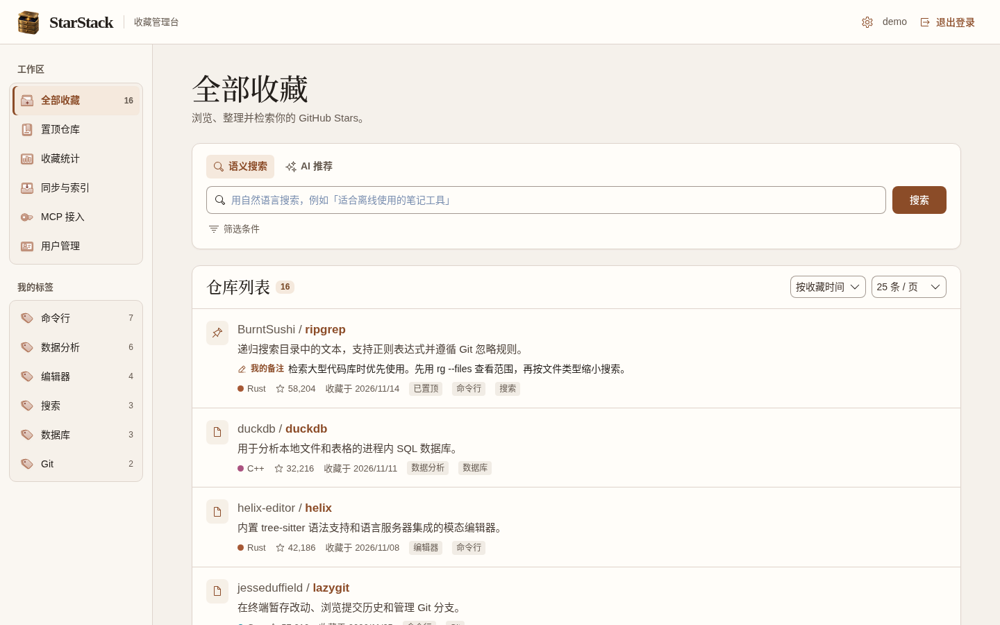](docs/screenshots/zh-desktop-light-library.webp) | [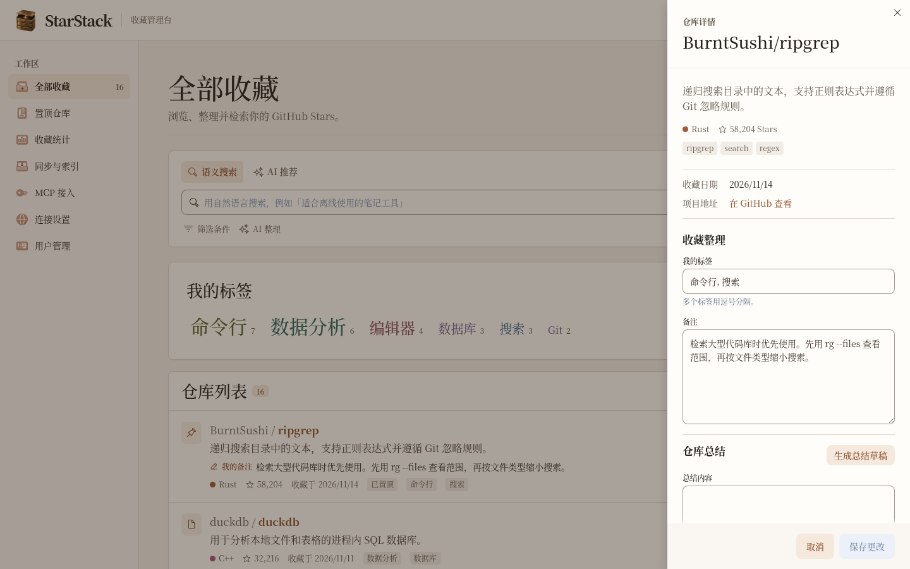](docs/screenshots/zh-desktop-light-detail.webp) | [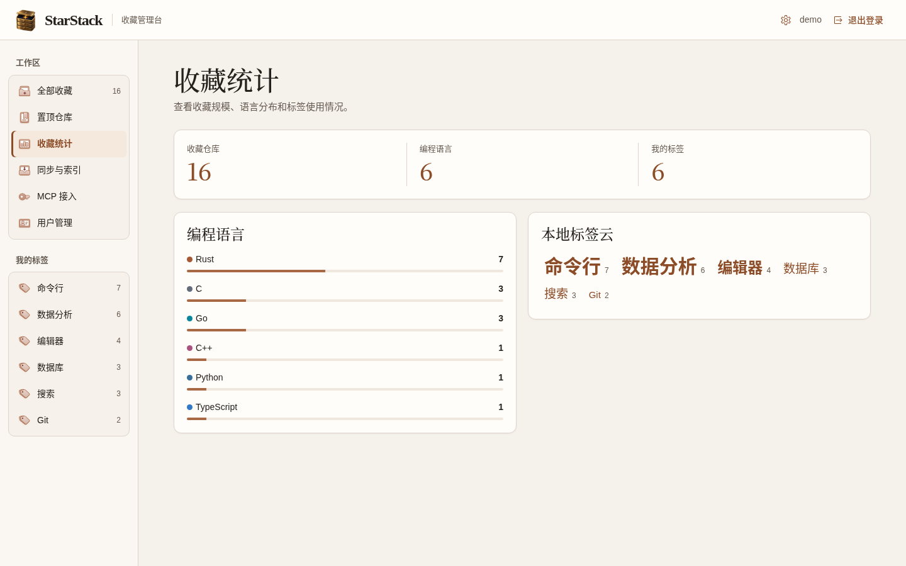](docs/screenshots/zh-desktop-light-statistics.webp) |

#### 深色

| 收藏库 | 仓库详情 | 收藏统计 |
| --- | --- | --- |
| [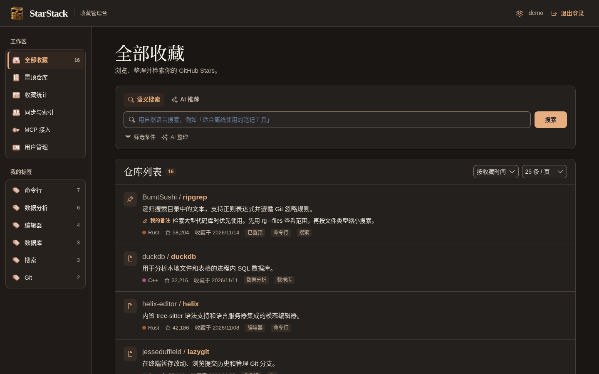](docs/screenshots/zh-desktop-dark-library.webp) | [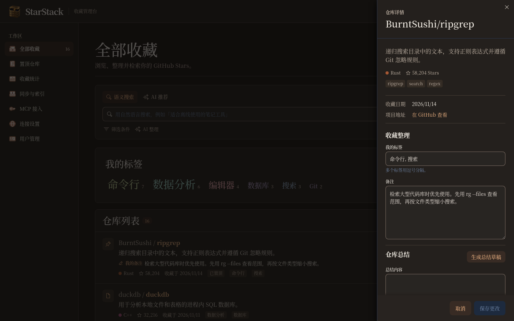](docs/screenshots/zh-desktop-dark-detail.webp) | [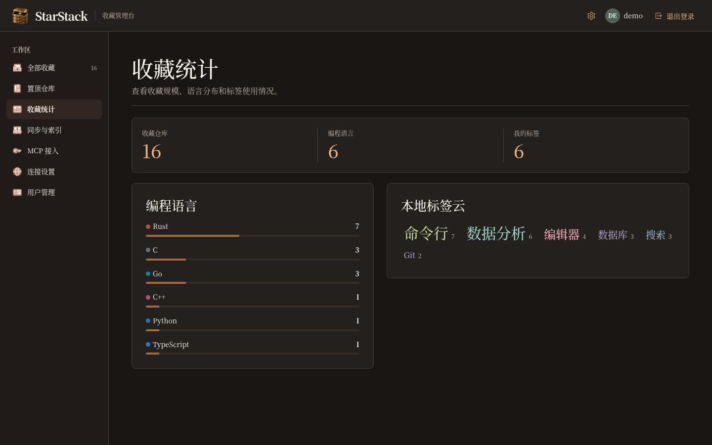](docs/screenshots/zh-desktop-dark-statistics.webp) |


### 手机 · 390 × 844

#### 浅色

| 收藏库 | 仓库详情 | 收藏统计 |
| --- | --- | --- |
| [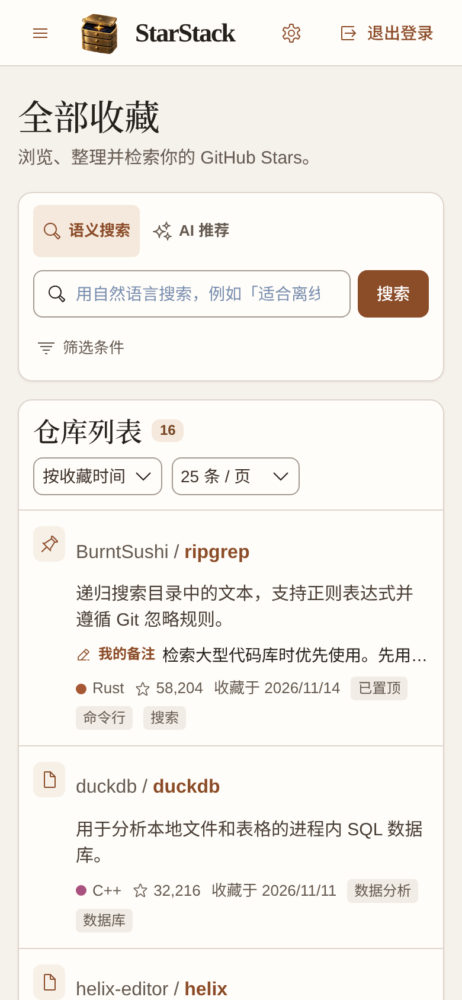](docs/screenshots/zh-mobile-light-library.webp) | [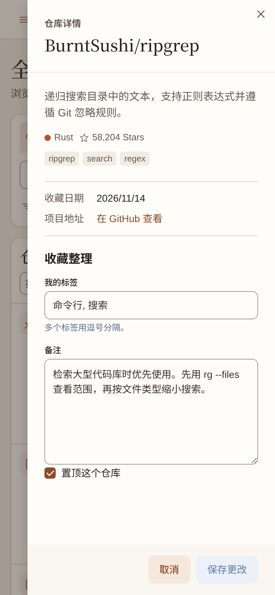](docs/screenshots/zh-mobile-light-detail.webp) | [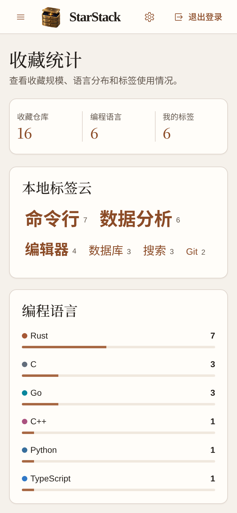](docs/screenshots/zh-mobile-light-statistics.webp) |

#### 深色

| 收藏库 | 仓库详情 | 收藏统计 |
| --- | --- | --- |
| [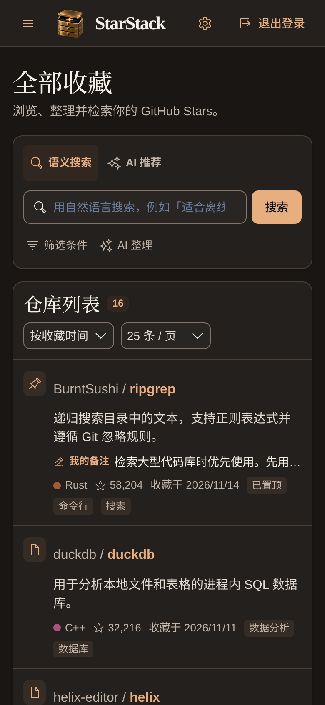](docs/screenshots/zh-mobile-dark-library.webp) | [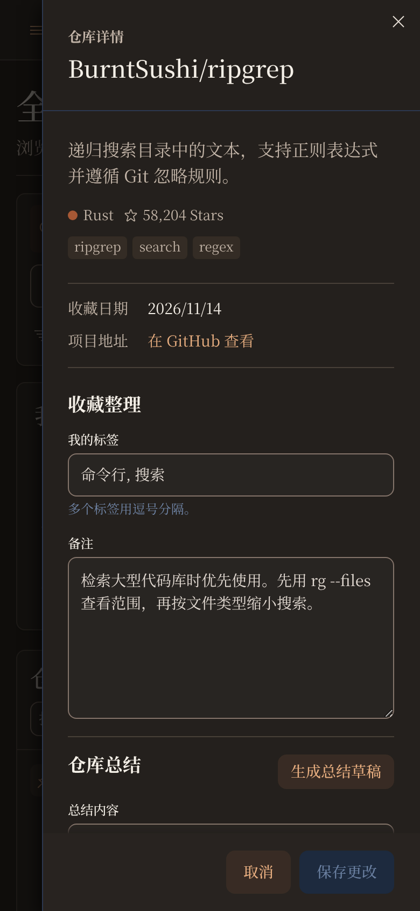](docs/screenshots/zh-mobile-dark-detail.webp) | [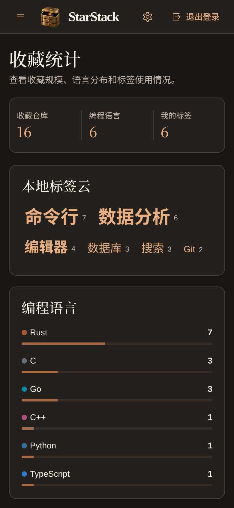](docs/screenshots/zh-mobile-dark-statistics.webp) |
