# 界面截图

截图来自独立的示例收藏库。仓库名称对应公开项目，Star 数量、收藏日期、标签和备注均为演示数据。点击图片可查看原图。

## 桌面 · 1440 × 900

### 浅色

| 收藏库 | 仓库详情 | 收藏统计 |
| --- | --- | --- |
| [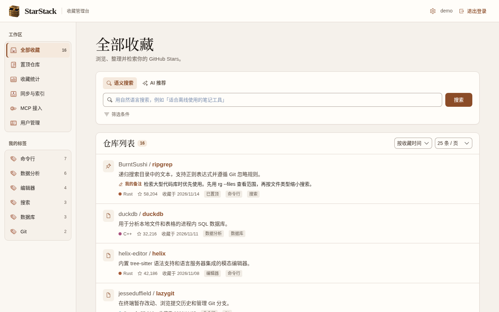](screenshots/zh-desktop-light-library.webp) | [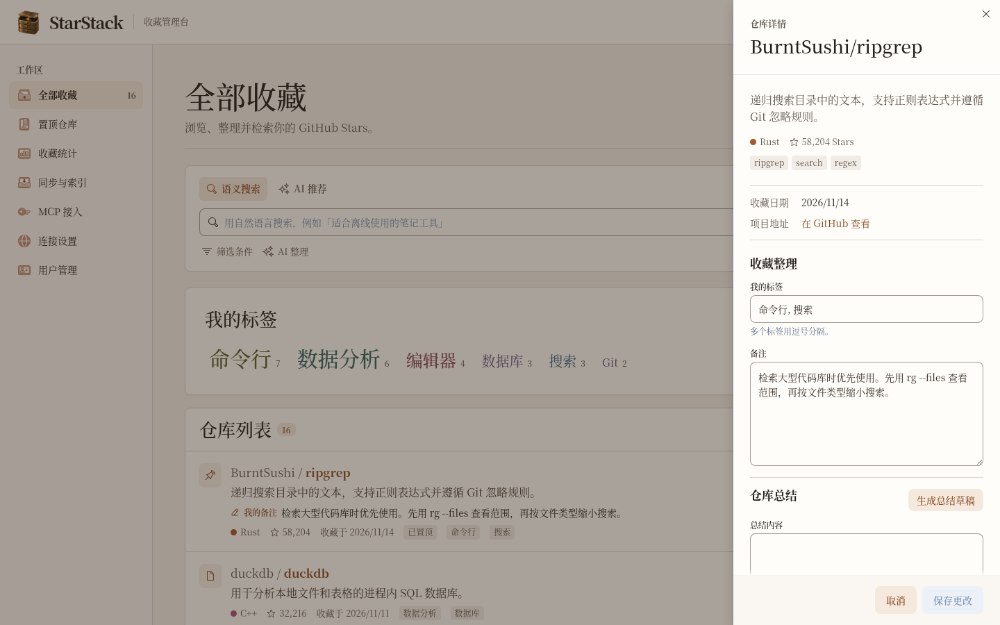](screenshots/zh-desktop-light-detail.webp) | [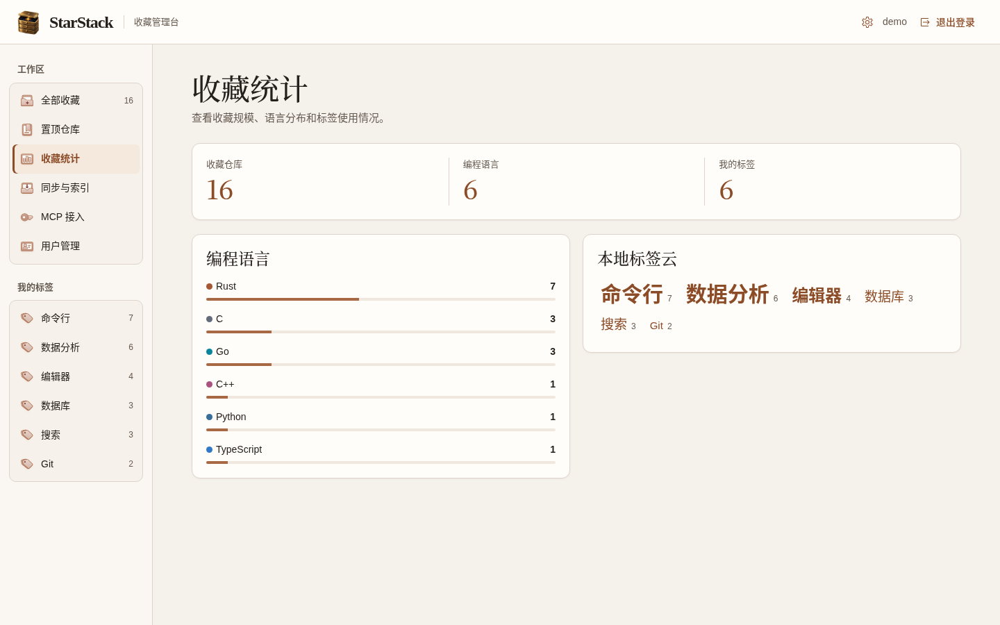](screenshots/zh-desktop-light-statistics.webp) |

### 深色

| 收藏库 | 仓库详情 | 收藏统计 |
| --- | --- | --- |
| [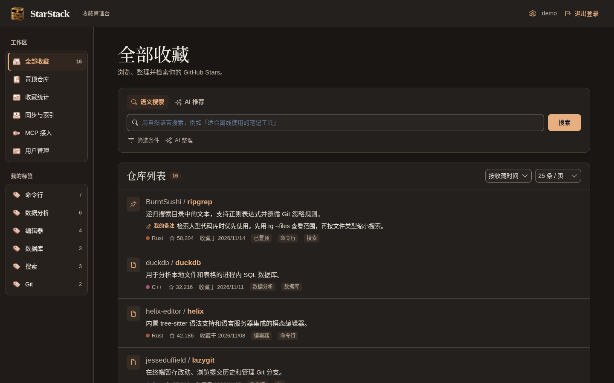](screenshots/zh-desktop-dark-library.webp) | [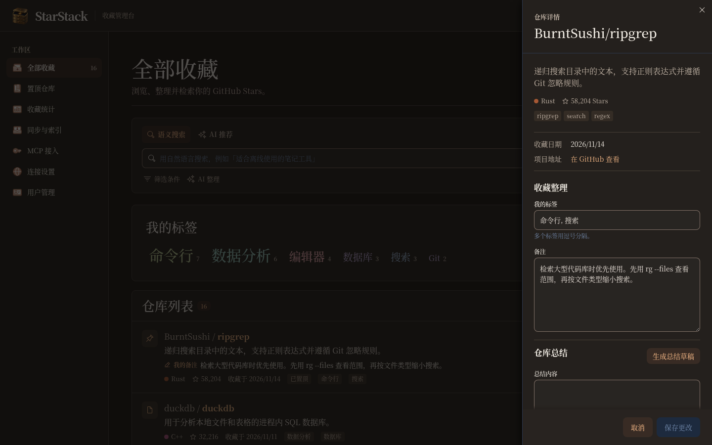](screenshots/zh-desktop-dark-detail.webp) | [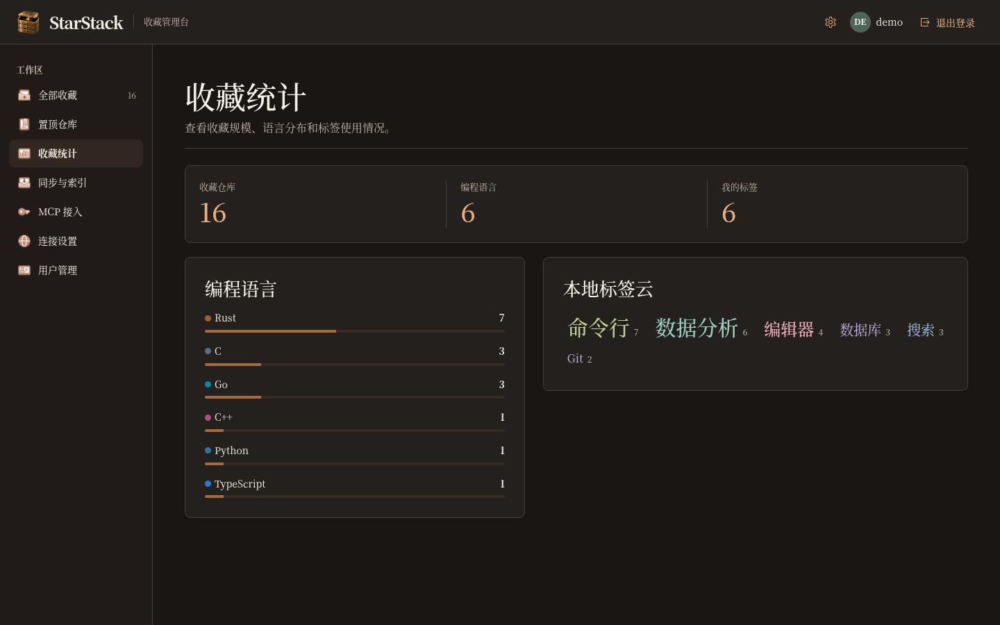](screenshots/zh-desktop-dark-statistics.webp) |

## 手机 · 390 × 844

### 浅色

| 收藏库 | 仓库详情 | 收藏统计 |
| --- | --- | --- |
| [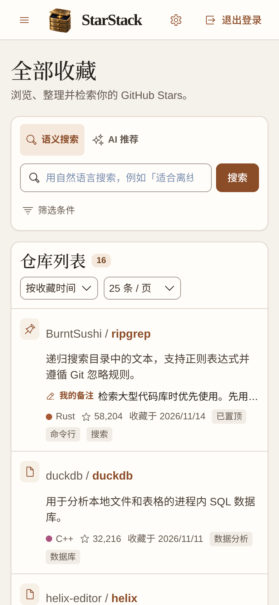](screenshots/zh-mobile-light-library.webp) | [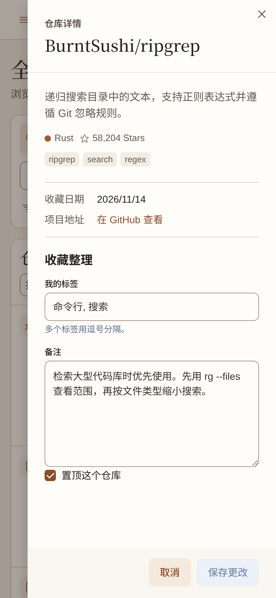](screenshots/zh-mobile-light-detail.webp) | [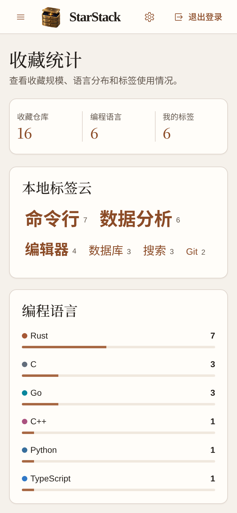](screenshots/zh-mobile-light-statistics.webp) |

### 深色

| 收藏库 | 仓库详情 | 收藏统计 |
| --- | --- | --- |
| [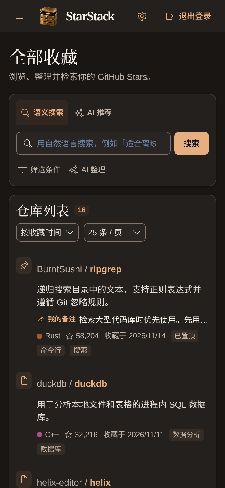](screenshots/zh-mobile-dark-library.webp) | [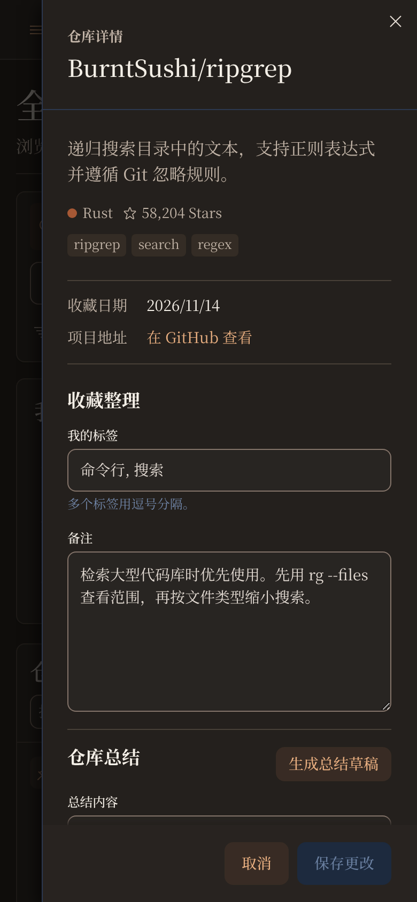](screenshots/zh-mobile-dark-detail.webp) | [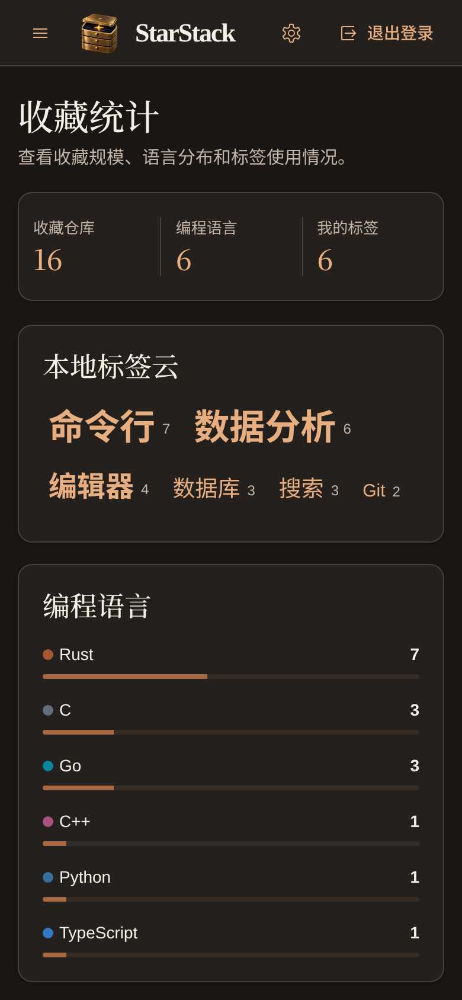](screenshots/zh-mobile-dark-statistics.webp) |
